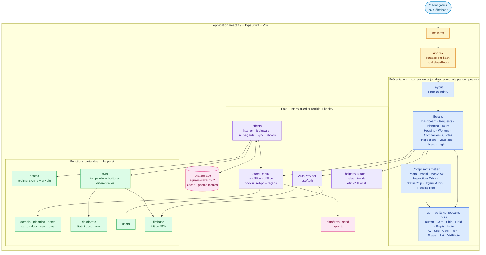
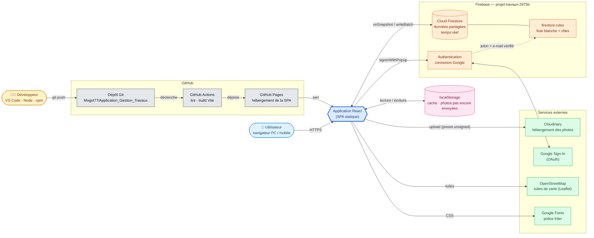

# Application Gestion Travaux

Application web responsive (PC et téléphone) de gestion de travaux : demandes, planning et tournées, logements, ouvriers, consultation d'entreprises et suivi des devis, constats, carte.

🔗 **Démo en ligne : https://mogot77.github.io/Application_Gestion_Travaux/**

## Technologies

| Domaine | Technologie |
|---|---|
| Framework UI | **React 19** |
| État global | **Redux Toolkit** + `react-redux` (Immer, listener middleware) |
| Langage | **TypeScript 6** (mode strict) |
| Build / dev server | **Vite 8** + `@vitejs/plugin-react` |
| Styles | **Tailwind CSS 4** (`@tailwindcss/vite`) + classes réutilisables dans `index.css` |
| Cartographie | **Leaflet** (fonds de carte en ligne) |
| Authentification | **Firebase Auth** (connexion Google) |
| Base de données | **Cloud Firestore** (temps réel, projet `travaux-2975b`) |
| Photos | **Cloudinary** (envoi direct, preset *unsigned* ; l'URL est stockée dans Firestore) |
| Qualité | **ESLint 10** (flat config, `typescript-eslint`, `react-hooks`, `react-refresh`) |
| Déploiement | **GitHub Pages** via **GitHub Actions** (`.github/workflows/deploy.yml`) |
| Stockage local | `localStorage` (cache des données, photos pas encore envoyées, état d'UI) |

## Architecture logicielle

### Schéma 1 — Architecture du front (React)



### Schéma 2 — Écosystème : services autour de l'application



### Flux de données

1. **Connexion** : Google via Firebase Auth ; l'e-mail doit figurer dans la collection `users` (liste blanche, vérifiée par `firestore.rules`).
2. **Chargement** : `AppProvider` crée le store Redux avec le cache `localStorage` comme état de départ, puis `store/effects` démarre `helpers/sync`, qui s'abonne en temps réel (`onSnapshot`) aux collections Firestore.
3. **Modification** : un écran appelle `useApp().mutate(fn)` → action Redux `mutated` (Immer applique `fn`). Le listener middleware sauvegarde le cache et `helpers/cloudState` découpe l'état en documents ; seuls les documents modifiés sont écrits (par lots).
4. **Photos** : `helpers/photos` redimensionne l'image et l'envoie à Cloudinary ; seule l'URL est stockée dans Firestore, donc partagée entre appareils. Hors ligne (ou sans configuration), la photo reste une data-URL locale, jamais envoyée à Firestore, puis envoyée au chargement suivant ou au retour du réseau.

### Collections Firestore

`users` (liste blanche et rôles), `ref`, `meta` (documents uniques `main`), `logements`, `ouvriers`, `entreprises`, `demandes`, `rdvs`, `constats`, `consultations` (un document par élément).

## Structure du projet

```
src/
├── App.tsx            routes (hash)
├── types.ts           types du modèle de données
├── data/              référentiels (refs.ts) et jeu de démo (seed.ts)
├── helpers/           fonctions partagées par plusieurs composants (domain, dates, csv, photos,
│                      carto, docs, planning, firebase, sync, cloudState, users, roles ...)
├── store/             Redux Toolkit : appSlice (données), uiSlice (toasts, chargement),
│                      effects (sauvegarde, Firestore, photos), AppProvider ;
│                      AuthProvider
├── hooks/             hooks partagés : useApp (façade sur le store), useAuth, useRoute,
│                      useUiState, useModal, useAppStore (hooks Redux typés)
├── components/        un dossier par composant : index.ts, <Nom>.tsx, types.ts,
│   │                  helpers.ts, constants.ts (alias d'import @/ = src/) ; les fonctions
│   │                  propres à un composant vivent dans son helpers.ts
│   ├── <Écran>/       Requests, Planning, Housing, Qualification, MapPage, Login ...
│   ├── Layout/ Modal/ Photo/ MapView/ InspectionsTable/ ...   composants métier
│   └── ui/            petits composants purs : Button, Card, Chip, Field, Empty,
│                      Note, Kv, Seg, Opts, Icon, Toasts, Ext, AddPhoto
└── index.css          thème Tailwind et classes réutilisables
firestore.rules        règles de sécurité Firestore
.claude/skills/        skills Claude Code du projet
```

## Skills Claude Code

Skills utilisés pour travailler sur ce projet avec Claude Code. Un skill est un jeu d'instructions que Claude charge quand la demande correspond (ou via `/nom`).

| Skill | Emplacement | Ce qu'il fait |
|---|---|---|
| `react-structure` | `.claude/skills/` (dans le repo) | Structure ou refactore les composants React : un dossier par composant (`index.ts`, `<Nom>.tsx`, `helpers.ts`, `constants.ts`, `types.ts`), petites primitives partagées dans `components/ui/`, fonctions fléchées, `type` plutôt que `interface`, alias `@/`, état au sommet. |
| `commit-push` | personnel (`~/.claude/skills/`) | Commit puis push du travail en cours : message en anglais, Conventional Commits, sans trailer de co-auteur ni de session. |
| `storybook-story` | personnel | Écrit une story Storybook (CSF3 + React + TypeScript) qui montre un vrai code d'usage plutôt que du JSX reconstruit depuis les args. |
| `project-edit` | personnel | Modifie le code d'un projet du dashboard `all` depuis n'importe quel dossier : retrouve le repo local et GitHub, édite, vérifie avec les scripts du projet, commit/push seulement sur demande. |

## Démarrage

```bash
npm install
npm run dev       # http://localhost:5173
```

| Commande | Rôle |
|---|---|
| `npm run dev` | serveur de développement |
| `npm run build` | `tsc -b` puis build Vite |
| `npm run lint` | ESLint |
| `npm run preview` | prévisualise le build |

> Sous PowerShell, si `npm` est bloqué : utiliser `npm.cmd` ou `Set-ExecutionPolicy -Scope CurrentUser RemoteSigned`.

## Points d'attention

- Clé de stockage local `equalis-travaux-v2` (format `{v:1, ...}`) : ne pas la changer sans migration.
- Photos : `VITE_CLOUDINARY_CLOUD` et `VITE_CLOUDINARY_PRESET` (voir `.env.example`) en local ; variables GitHub Actions pour le site en ligne.
- `TODAY = '2026-10-29'` est une date de référence de démo, indépendante de la date réelle.
- Avant de pousser : `npm run lint` et `npm run build` doivent passer.
- Le bundle dépasse 500 kB (avertissement Vite non bloquant).
- Les polices et fonds de carte nécessitent internet.
