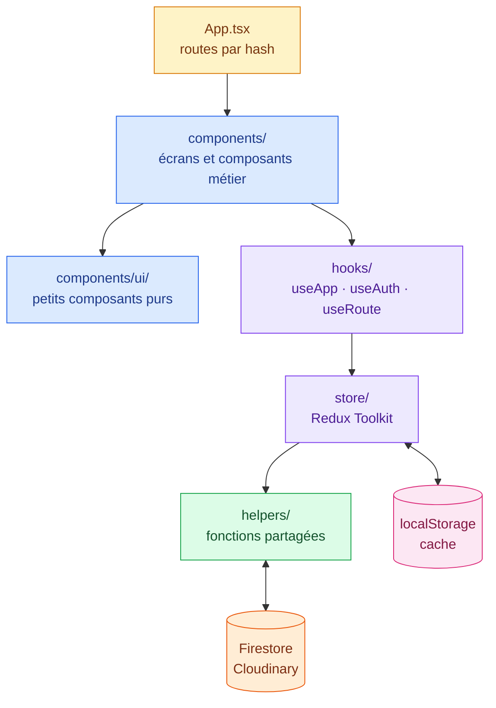
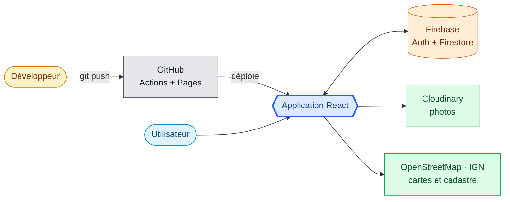

# Application Gestion Travaux

Application web responsive (PC et téléphone) de gestion de travaux : demandes, planning et tournées, logements, ouvriers, consultation d'entreprises et suivi des devis, constats, carte.

🔗 **Démo en ligne : https://mogot77.github.io/Application_Gestion_Travaux/**

📚 **Storybook (composants) : https://mogot77.github.io/Application_Gestion_Travaux/storybook/**

## Technologies

| Domaine | Technologie |
|---|---|
| Framework UI | **React 19** |
| État global | **Redux Toolkit** + `react-redux` (Immer, listener middleware) |
| Langage | **TypeScript 6** (mode strict) |
| Build / dev server | **Vite 8** + `@vitejs/plugin-react` |
| Styles | **Tailwind CSS 4** (`@tailwindcss/vite`) + classes réutilisables dans `index.css`, thème clair/sombre par jetons CSS |
| Cartographie | **Leaflet** (fonds OpenStreetMap et satellite, couche cadastre IGN gratuite) |
| Authentification | **Firebase Auth** (connexion Google) |
| Base de données | **Cloud Firestore** (temps réel, projet `travaux-2975b`) |
| Photos | **Cloudinary** (envoi direct, preset *unsigned* ; l'URL est stockée dans Firestore) |
| Composants | **Storybook 10** (catalogue des composants, publié dans `/storybook`) |
| Qualité | **ESLint 10** (flat config, `typescript-eslint`, `react-hooks`, `react-refresh`) |
| Déploiement | **GitHub Pages** via **GitHub Actions** (`.github/workflows/deploy.yml`) |
| Stockage local | `localStorage` (cache des données, photos pas encore envoyées, état d'UI) |

## Architecture logicielle

### Schéma 1 — Architecture du front



### Schéma 2 — Écosystème



### Flux de données

1. **Connexion** : Google via Firebase Auth ; l'e-mail doit figurer dans la collection `users` (liste blanche, vérifiée par `firestore.rules`).
2. **Chargement** : `AppProvider` crée le store Redux avec le cache `localStorage` comme état de départ, puis `store/listeners` démarre `store/queries/appSync`. La première lecture (ou une lecture de plus de 24 h) est complète ; les suivantes sont **incrémentales** : le cache local sert de base et seuls les documents modifiés depuis le dernier `updatedAt` lu sont relus, ce qui limite les lectures Firestore. Une suppression laisse une « pierre tombale » (`deleted: true`) pour que les autres clients la voient. Le cache local et le curseur (`equalis-travaux-sync-v1`) vont ensemble : `resetLocal` efface les deux.
3. **Modification** : un écran appelle `useApp().mutate(fn)` → action Redux `mutated` (Immer applique `fn`). Les listeners du store sauvegardent le cache et `helpers/cloudState` découpe l'état en documents ; seuls les documents modifiés sont écrits, et **seulement les champs modifiés**, par lots. À la réception, une fusion à trois voies garde vos modifications en cours : deux personnes qui changent des champs différents d'une même demande ne s'écrasent pas (un même champ reste « dernier écrit gagne »). Une écriture refusée est retentée automatiquement.
4. **Numéros** : les numéros lisibles (DI, CE, CS, FT, BC) viennent d'un compteur Firestore atomique (`meta/counters`), jamais d'un compteur local, donc deux utilisateurs ne reçoivent jamais le même. Hors ligne, un numéro de secours unique est utilisé.
5. **Photos** : `helpers/photos` redimensionne l'image et l'envoie à Cloudinary ; seule l'URL est stockée dans Firestore, donc partagée entre appareils. Hors ligne (ou sans configuration), la photo reste une data-URL locale, jamais envoyée à Firestore, puis envoyée au chargement suivant ou au retour du réseau.

### Collections Firestore

`users` (liste blanche et rôles), `ref`, `meta` (documents uniques `main`), `logements`, `ouvriers`, `entreprises`, `demandes`, `rdvs`, `constats`, `consultations` (un document par élément).

## Structure du projet

```
src/
├── App.tsx            routes (hash)
├── types/             types du modèle de données (par domaine)
├── helpers/           fonctions partagées par plusieurs composants (domain, dates, csv, photos,
│                      carto, docs, planning, cloudState, roles, emptyState ...)
├── store/             Redux Toolkit : index (store), reducers/ (app, ui), selectors/, thunks/,
│                      listeners/ (sauvegarde, Firestore, photos, cycle de vie), queries/ (Firestore,
│                      cache local, utilisateurs), local/ (état d'UI, modale), providers/
├── hooks/             hooks partagés : useApp (façade sur le store), useAuth, useRoute,
│                      useUiState, useModal, useAppStore (hooks Redux typés)
├── components/        un dossier par composant : index.ts, <Nom>.tsx, types.ts,
│   │                  helpers.ts, constants.ts (alias d'import @/ = src/) ; les fonctions
│   │                  propres à un composant vivent dans son helpers.ts
│   ├── <Écran>/       Requests, Planning, Housing, Qualification, MapPage, Login ... :
│   │                  conteneur <Nom>.tsx (store) + vue <Nom>View.tsx (props seules) + stories
│   ├── Layout/ Modal/ Photo/ MapView/ InspectionsTable/ ...   composants métier
│   └── ui/            petits composants purs : Button, Card, Chip, Field, Empty,
│                      Note, Kv, Seg, Opts, Icon, Toasts, Ext, AddPhoto, SearchBox,
│                      FilterSelect, Kpi, Tabs, PageHead, Crumb, StepHeader
├── stories/           données factices pour Storybook (jamais utilisées par l'application)
└── index.css          thème Tailwind et classes réutilisables
firestore.rules        règles de sécurité Firestore
.claude/skills/        skills Claude Code du projet
```

## Sécurité

### La configuration Firebase n'est pas un secret

Les variables `VITE_FIREBASE_*` (clé d'API, identifiant de projet, domaine d'authentification, etc.) **ne sont pas ce qui protège les données**. Elles sont publiques par conception :

- Elles servent seulement à dire au navigateur *quel* projet Firebase contacter. Sans elles, l'application ne saurait pas où se connecter.
- Elles finissent obligatoirement dans le JavaScript envoyé à chaque visiteur : toute application web Firebase les expose, c'est le fonctionnement normal du SDK. Les mettre en variables d'environnement GitHub évite de les écrire dans le dépôt, mais ne les cache pas dans le site construit.
- Connaître la clé d'API ne donne **aucun accès** aux données : elle n'identifie pas un utilisateur et n'autorise rien.

### Ce qui protège réellement les données

1. **Les règles Firestore** (`firestore.rules`, publiées dans la console Firebase) : toute lecture ou écriture exige un compte Google connecté, avec une adresse e-mail vérifiée, présente dans la liste blanche `users`. Un visiteur qui connaît la configuration est refusé par le serveur.
2. **La liste blanche** : seule la direction (rôle `admin` ou `directeur`) peut ajouter ou retirer des comptes autorisés.
3. **Les domaines autorisés** de la connexion Google (console Firebase, Authentication) : seuls ces sites peuvent lancer la connexion.
4. **Photos** : l'adresse d'une photo (Cloudinary) est longue et impossible à deviner, et n'est lisible que par les comptes autorisés (elle est dans Firestore), mais quiconque possède le lien peut la voir sans se connecter. Supprimer une photo dans l'application ne la supprime pas chez Cloudinary.
5. **Aucun vrai secret côté navigateur** : les photos partent sur Cloudinary avec un *preset unsigned* (le nom du compte et du preset sont publics, l'API secret Cloudinary n'est jamais utilisée dans l'application).

### À savoir

- Les règles distinguent « membre » et « administrateur » ; les rôles plus fins (établissement, ouvrier, coordination) restreignent l'affichage dans l'application, pas l'accès aux données côté serveur. Tout compte de la liste blanche peut en principe lire les données de l'application.
- Ne jamais committer de **secret** : clé privée de compte de service, API secret Cloudinary, mot de passe. Ceux-là ne vont ni dans le dépôt ni dans une variable `VITE_*` (qui serait exposée au navigateur).
- Option complémentaire : restreindre la clé d'API aux domaines du site dans la console Google Cloud (API et services, Identifiants) limite son usage par des tiers.

## Consignes pour Claude Code

Le `CLAUDE.md` à la racine donne la vue d'ensemble ; chaque gros dossier a le sien avec ses règles détaillées : `src/store/`, `src/components/`, `src/helpers/`, `src/hooks/` et `src/stories/`.

## Skills Claude Code

Skills utilisés pour travailler sur ce projet avec Claude Code. Un skill est un jeu d'instructions que Claude charge quand la demande correspond (ou via `/nom`).

| Skill | Emplacement | Ce qu'il fait |
|---|---|---|
| `react-structure` | `.claude/skills/` (dans le repo) | Structure ou refactore les composants React : un dossier par composant (`index.ts`, `<Nom>.tsx`, `helpers.ts`, `constants.ts`, `types.ts`), petites primitives partagées dans `components/ui/`, fonctions fléchées, `type` plutôt que `interface`, alias `@/`, état au sommet. |
| `commit-push` | personnel (`~/.claude/skills/`) | Commit puis push du travail en cours : message en anglais, Conventional Commits, sans trailer de co-auteur ni de session. |
| `storybook-story` | personnel | Écrit une story Storybook (CSF3 + React + TypeScript) qui montre un vrai code d'usage plutôt que du JSX reconstruit depuis les args. |

## Démarrage

```bash
npm install
copy .env.example .env.local   # puis renseigner les valeurs (voir ci-dessous)
npm run dev                    # http://localhost:5173
```

### Configuration (`.env.local`)

Le fichier `.env.local` n'est pas versionné : chaque personne crée le sien à partir de `.env.example`, puis redémarre `npm run dev` (Vite ne le relit qu'au démarrage).

| Variable | Où la trouver |
|---|---|
| `VITE_FIREBASE_API_KEY`, `_AUTH_DOMAIN`, `_PROJECT_ID`, `_STORAGE_BUCKET`, `_MESSAGING_SENDER_ID`, `_APP_ID` | console Firebase → Paramètres du projet → Vos applications |
| `VITE_CLOUDINARY_CLOUD`, `VITE_CLOUDINARY_PRESET` | Cloudinary → Settings (cloud name) et preset *unsigned* |
| `VITE_TODAY` (facultatif) | date forcée `AAAA-MM-JJ` pour une démo ; vide = date réelle |

Pour le site en ligne, ces mêmes variables se créent dans GitHub → Settings → Secrets and variables → Actions → **Variables**. Sans elles, l'application s'arrête avec un message clair.

| Commande | Rôle |
|---|---|
| `npm run dev` | serveur de développement |
| `npm run build` | `tsc -b` puis build Vite |
| `npm run lint` | ESLint |
| `npm run preview` | prévisualise le build |
| `npm run storybook` | Storybook en local (http://localhost:6006) |
| `npm run build-storybook` | construit le Storybook statique |

> Sous PowerShell, si `npm` est bloqué : utiliser `npm.cmd` ou `Set-ExecutionPolicy -Scope CurrentUser RemoteSigned`.

## Points d'attention

- Clé de stockage local `equalis-travaux-v2` (format `{v:1, ...}`) : ne pas la changer sans migration.
- Configuration : variables `VITE_FIREBASE_*` et `VITE_CLOUDINARY_*` (voir `.env.example`) dans `.env.local` en local, et dans les variables GitHub Actions pour le site en ligne.
- `TODAY` (`helpers/dates.ts`) est la date du jour ; la variable facultative `VITE_TODAY` (AAAA-MM-JJ) force une date pour une démo ou des tests.
- Avant de pousser : `npm run lint` et `npm run build` doivent passer.
- Chargement : chaque écran est chargé à la demande, Leaflet seulement sur les cartes. Le fichier Firebase (≈ 640 kB) est nécessaire dès la connexion : c'est lui qui déclenche l'avertissement Vite « plus de 500 kB », sans effet bloquant.
- Données : aucun jeu de démo ni référentiel dans le code, tout vient de Firestore (référentiels modifiables dans l'écran Référentiels). Un nouveau projet Firebase démarre donc vide.
- Les fichiers de migration des référentiels (`src/store/listeners/refsMigration.ts`, `src/store/queries/legacyRefs.ts`) sont à supprimer une fois la nouvelle version passée en production.
- Les polices et fonds de carte nécessitent internet.
