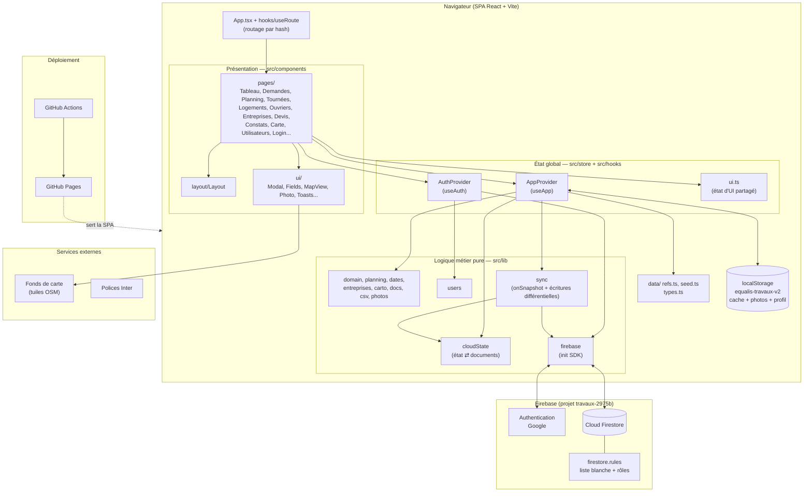

# Application Gestion Travaux

Application web responsive (PC et téléphone) de gestion de travaux : demandes, planning et tournées, logements, ouvriers, consultation d'entreprises et suivi des devis, constats, carte.

🔗 **Démo en ligne : https://mogot77.github.io/Application_Gestion_Travaux/**

## Technologies

| Domaine | Technologie |
|---|---|
| Framework UI | **React 19** |
| Langage | **TypeScript 6** (mode strict) |
| Build / dev server | **Vite 8** + `@vitejs/plugin-react` |
| Styles | **Tailwind CSS 4** (`@tailwindcss/vite`) + classes réutilisables dans `index.css` |
| Cartographie | **Leaflet** (fonds de carte en ligne) |
| Authentification | **Firebase Auth** (connexion Google) |
| Base de données | **Cloud Firestore** (temps réel, projet `travaux-2975b`) |
| Qualité | **ESLint 10** (flat config, `typescript-eslint`, `react-hooks`, `react-refresh`) |
| Déploiement | **GitHub Pages** via **GitHub Actions** (`.github/workflows/deploy.yml`) |
| Stockage local | `localStorage` (cache, photos, profil) |

## Architecture logicielle



### Flux de données

1. **Connexion** : Google via Firebase Auth ; l'e-mail doit figurer dans la collection `users` (liste blanche, vérifiée par `firestore.rules`).
2. **Chargement** : `AppProvider` affiche d'abord le cache `localStorage`, puis `lib/sync` s'abonne en temps réel (`onSnapshot`) aux collections Firestore.
3. **Modification** : l'état est mis à jour localement ; `lib/cloudState` le découpe en documents et seuls les documents modifiés sont écrits (par lots).
4. **Photos** : jamais envoyées à Firestore, elles restent dans le `localStorage` de l'appareil.

### Collections Firestore

`users` (liste blanche et rôles), `ref`, `meta` (documents uniques `main`), `logements`, `ouvriers`, `entreprises`, `demandes`, `rdvs`, `constats`, `consultations` (un document par élément).

## Structure du projet

```
src/
├── App.tsx            routes (hash)
├── types.ts           interfaces du modèle de données
├── data/              référentiels (refs.ts) et jeu de démo (seed.ts)
├── lib/               logique métier pure (domain, dates, csv, photos, carto, docs,
│                      planning, entreprises, firebase, sync, cloudState, users)
├── store/             AppProvider, AuthProvider, contextes, état d'UI
├── hooks/             useApp, useAuth, useRoute
├── components/
│   ├── ui/            modale, champs, carte, photos, toasts...
│   ├── layout/        gabarit général
│   └── pages/         écrans
└── index.css          thème Tailwind et classes réutilisables
firestore.rules        règles de sécurité Firestore
```

## Démarrage

```bash
npm install
npm run dev       # http://localhost:5173
```

| Commande | Rôle |
|---|---|
| `npm run dev` | serveur de développement |
| `npm run build` | `tsc -b` puis build Vite |
| `npm run lint` | ESLint |
| `npm run preview` | prévisualise le build |

> Sous PowerShell, si `npm` est bloqué : utiliser `npm.cmd` ou `Set-ExecutionPolicy -Scope CurrentUser RemoteSigned`.

## Points d'attention

- Clé de stockage local `equalis-travaux-v2` (format `{v:1, ...}`) : ne pas la changer sans migration.
- `TODAY = '2026-10-29'` est une date de référence de démo, indépendante de la date réelle.
- Avant de pousser : `npm run lint` et `npm run build` doivent passer.
- Le bundle dépasse 500 kB (avertissement Vite non bloquant).
- Les polices et fonds de carte nécessitent internet.
