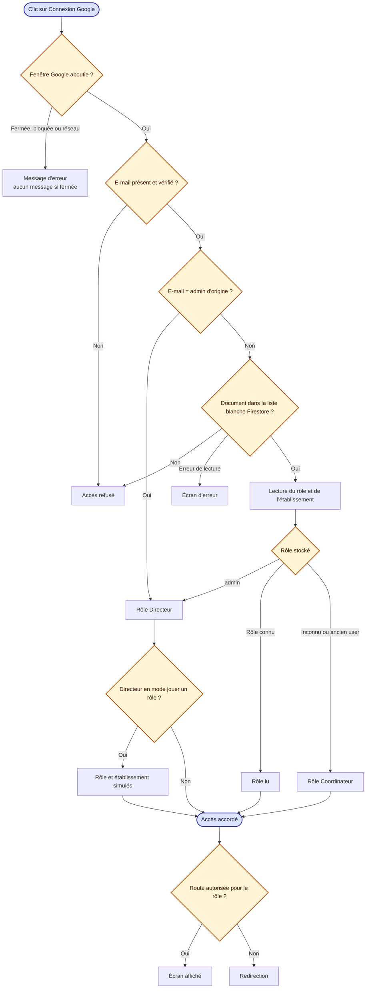
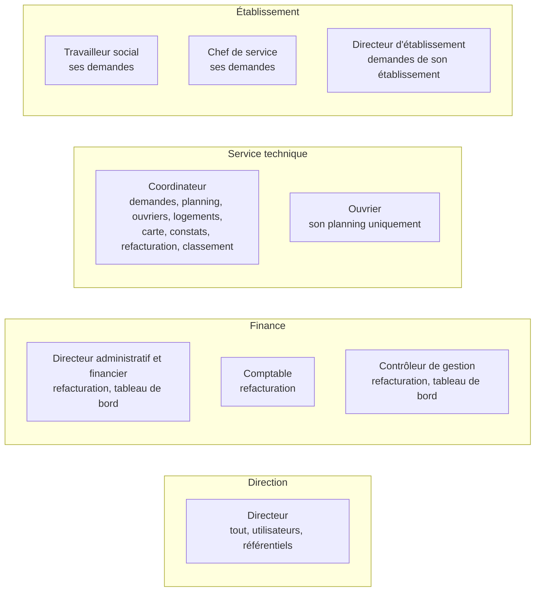

# 1. Connexion, liste blanche et droits

Sources : `store/providers/AuthProvider.tsx`, `store/queries/users.ts`, `helpers/roles.ts`.

## Droits par rôle

Les droits précis des rôles Finance (qui crée, émet ou valide une facture) restent à déterminer : aujourd'hui les trois ont le même accès à la refacturation.
