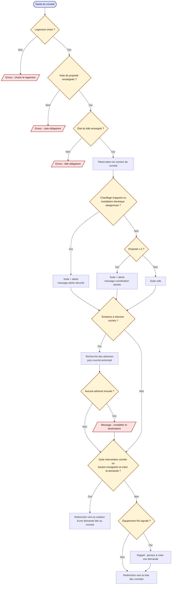

# 2. Constat d'état : scénarios, suites et échelons

Sources : `helpers/constatSuites.ts`, `components/NewInspection/NewInspection.tsx`.

## 2.1 Enregistrement du constat

## 2.2 Scénarios recommandés (un constat peut en cumuler plusieurs)

```mermaid
flowchart TD
    S([Constat saisi]) --> T1{Chauffage d'appoint, électrique<br/>dangereuse, détecteur de fumée ?}
    T1 -- Oui --> R1["Risque sécurité<br/>Suites : intervention, prévention<br/>Échelons : coordinateur, dir. établissement, directeur"]
    S --> T2{Équipement HS ?}
    T2 -- Oui --> R2["Équipement hors service<br/>Suite : intervention<br/>Échelon : coordinateur"]
    S --> T3{Nuisibles ?}
    T3 -- Oui --> R3["Nuisibles<br/>Suites : intervention, ménages<br/>Échelons : coordinateur, chef de service"]
    S --> T4{Humidité, VMC ou aérations ?}
    T4 -- "Humidité ou VMC" --> R4a["Suites : intervention, prévention<br/>Échelons : travailleur social, coordinateur"]
    T4 -- "Aérations seules" --> R4b["Suite : prévention<br/>Échelons : travailleur social, coordinateur"]
    S --> T5{Linge séchant ?}
    T5 -- Oui --> R5["Séchage du linge<br/>Suite : prévention<br/>Échelon : travailleur social"]
    S --> T6{Encombrement ou odeurs ?}
    T6 -- Oui --> R6["Suites : ménages, prévention<br/>Échelons : travailleur social, chef de service"]
    S --> T7{Animaux ?}
    T7 -- Oui --> R7["Suite : prévention<br/>Échelons : travailleur social, chef de service"]
    S --> T8{Dégradations ?}
    T8 -- Oui --> R8["Suites : intervention, prévention<br/>Échelons : chef de service, dir. établissement"]
    S --> T9{Drogues ?}
    T9 -- Oui --> R9["Suites : prévention, fin de prise en charge<br/>Échelons : chef de service, dir. établissement, directeur"]
    S --> T10{Propreté ≤ 2 ?}
    T10 -- "Propreté ≤ 1" --> R10a["Logement insalubre<br/>Suites : ménages, prévention<br/>Échelons : TS, chef de service, dir. établissement"]
    T10 -- "Propreté = 2" --> R10b["Suite : ménages<br/>Échelons : TS, chef de service"]
    T10 -- "≤ 2" --> T11{Constat ≤ 2 sur ce logement<br/>dans les 120 derniers jours ?}
    T11 -- Oui --> R11["Récidive<br/>Suite : fin de prise en charge<br/>Échelons : dir. établissement, directeur"]
    S --> T12{Bâti Dégradé et aucun scénario<br/>n'a déjà prévu d'intervention ?}
    T12 -- Oui --> R12["Bâti dégradé<br/>Suite : intervention<br/>Échelons : coordinateur, dir. établissement"]
    %% styles communs
    classDef dec fill:#fff4d6,stroke:#b45309,stroke-width:2px,color:#431407
    classDef term fill:#dbe4ff,stroke:#3730a3,stroke-width:2px,color:#1e1b4b
    classDef err fill:#fde2e2,stroke:#b91c1c,stroke-width:2px,color:#450a0a
    classDef ok fill:#dcfce7,stroke:#15803d,stroke-width:2px,color:#052e16
    class T1,T2,T3,T4,T5,T6,T7,T8,T9,T10,T11,T12 dec
    class S term
```

Les suites et échelons proposés sont l'union de ceux de tous les scénarios déclenchés. Les échelons d'établissement ne reçoivent que les constats de leur établissement.
