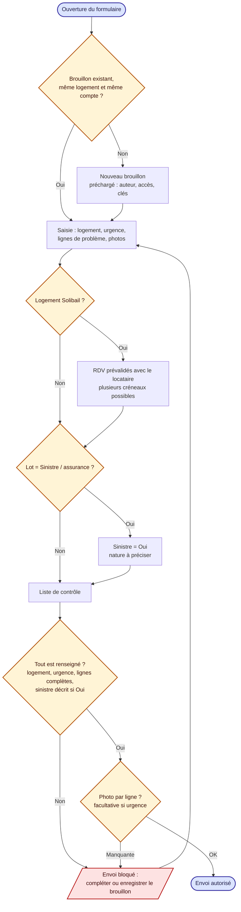
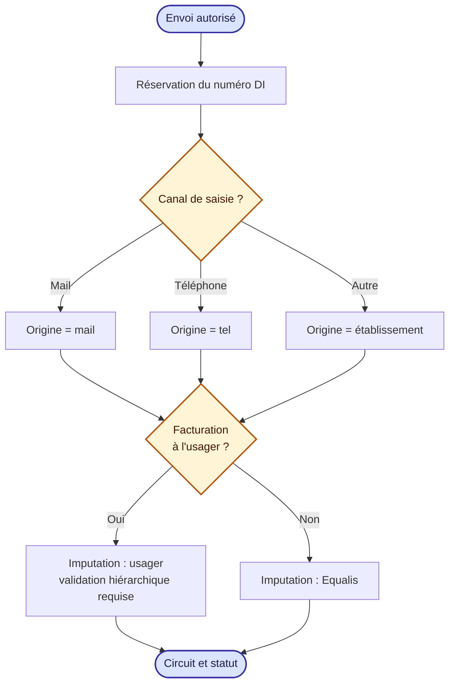
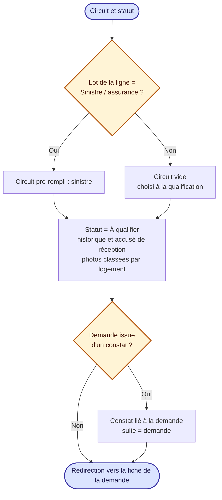

# 3. Création d'une demande d'intervention

Sources : `components/NewRequest/NewRequest.tsx`, `components/NewRequest/helpers.ts`.

Les demandes émanent des établissements (sauf cas exceptionnels). Le canal indique comment elles sont saisies : « Autre » correspond à une saisie directement par l'établissement.

## 3.1 Saisie et contrôle avant envoi

La photo est obligatoire pour chaque ligne, **sauf si la demande est urgente**. Pour un logement Solibail, l'agent peut indiquer des rendez-vous prévalidés avec le locataire (conseillé, non bloquant).

## 3.2 Envoi : numéro, origine et imputation

## 3.3 Circuit, statut et redirection

