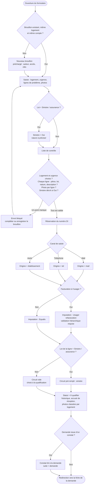

# 3. Création d'une demande d'intervention

Sources : `components/NewRequest/NewRequest.tsx`, `components/NewRequest/helpers.ts`.

Les demandes émanent des établissements (sauf cas exceptionnels). Le canal ci-dessous indique comment elles sont saisies : « Autre » correspond à une saisie directement par l'établissement.

