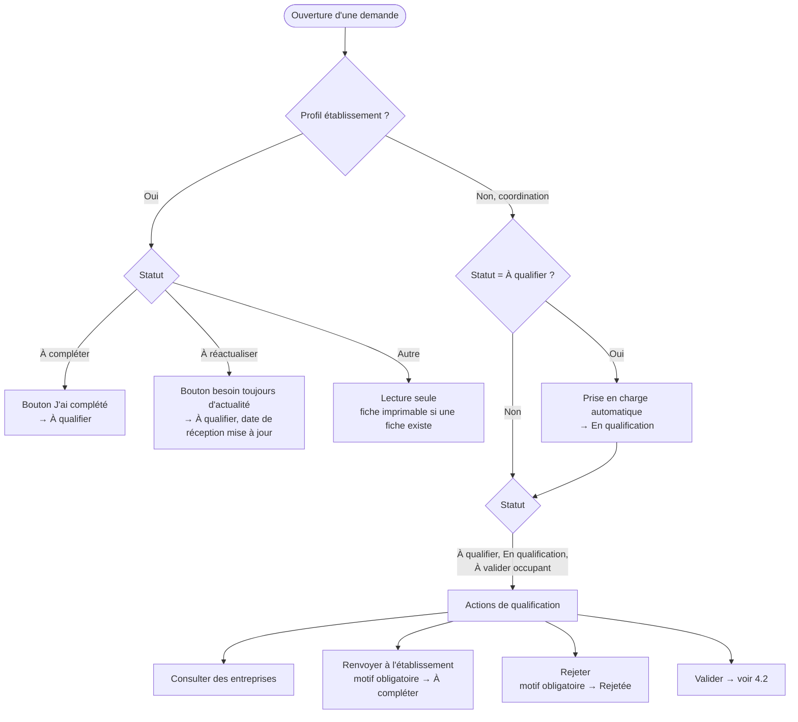
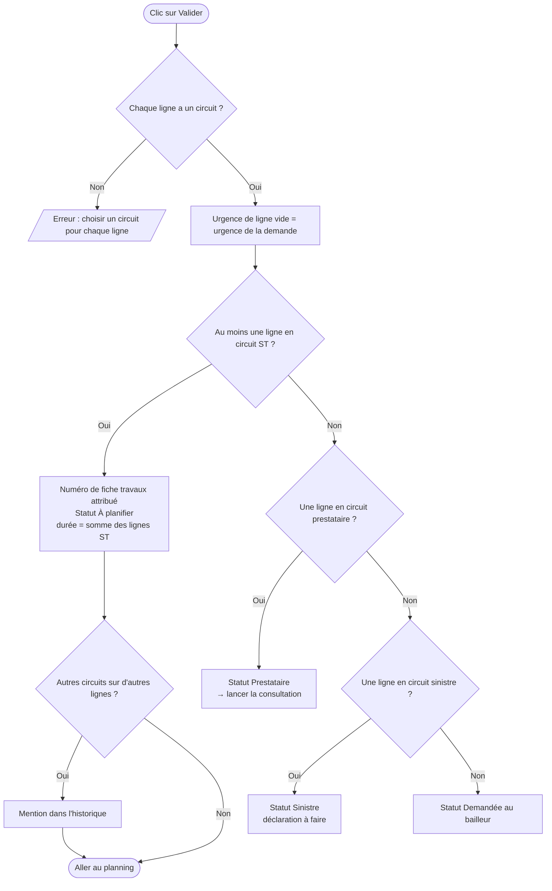

# 4. Qualification et choix du circuit

Sources : `components/Qualification/Qualification.tsx`, `components/Qualification/helpers.ts`.

## 4.1 Entrée en qualification

Demande de plus de deux mois sans intervention : statut **À réactualiser**. Sans réactualisation avant J+80, rejet automatique (motif « Non réactualisée »). La coordination peut relancer le demandeur, marquer la demande réactualisée ou la rejeter.

## 4.2 Validation : le circuit décide du statut suivant

Choisir le circuit **bailleur** sur une ligne force l'imputation « Bailleur propriétaire ». Priorité des circuits : ST, puis prestataire, puis sinistre, puis bailleur.

## 4.3 Suites hors service technique

```mermaid
flowchart TD
    subgraph Bailleur
      B1[Demandée au bailleur] --> B2{Action}
      B2 -- Relancer --> B1
      B2 -- "Travaux faits par le bailleur" --> BC[Clôturée]
    end
    subgraph Prestataire
      P1[Prestataire] --> P2{Action}
      P2 -- "Intervention réalisée" --> P3[Réalisée, à réceptionner]
      P3 --> PC[Réceptionner → Clôturée]
    end
    subgraph Sinistre
      S1[Sinistre] --> S2{Action}
      S2 -- "Déclaration envoyée à l'assureur" --> S1
      S2 -- "Indemnisation actée" --> S3[Lignes → circuit ST<br/>numéro de fiche<br/>statut À planifier]
    end
```

