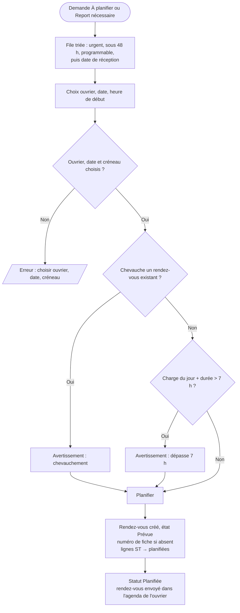
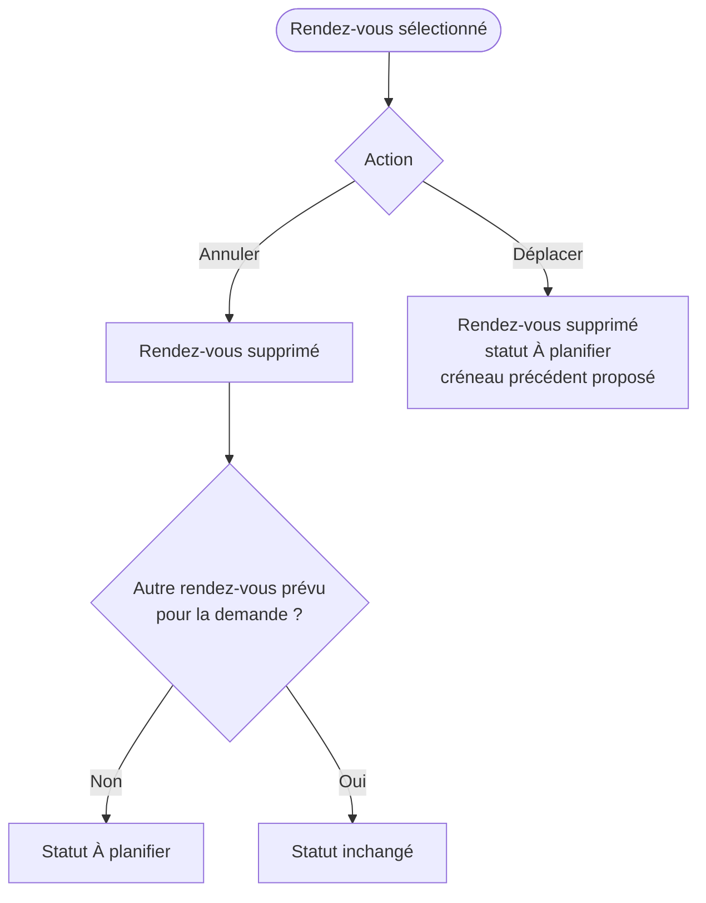
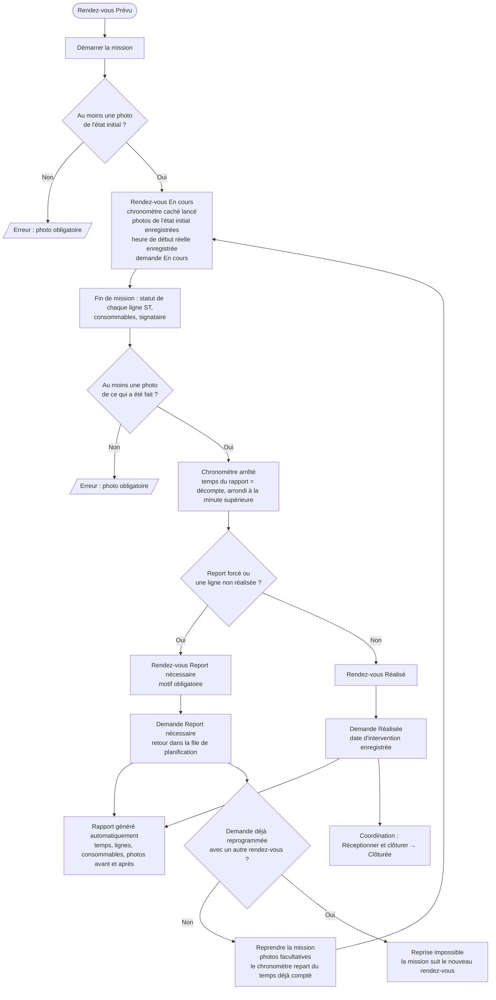

# 5. Planification, déroulement et fin de mission

Sources : `components/Planning/PlanPanel.tsx`, `AppointmentPanel.tsx`, `helpers.ts`, `helpers/mission.ts`.

## 5.1 Planification

## 5.2 Modification d'un rendez-vous prévu

## 5.3 Déroulement de la mission par l'ouvrier

Le temps du rapport vient d'un chronomètre caché (jamais affiché), lancé au démarrage ou à la reprise de la mission.

