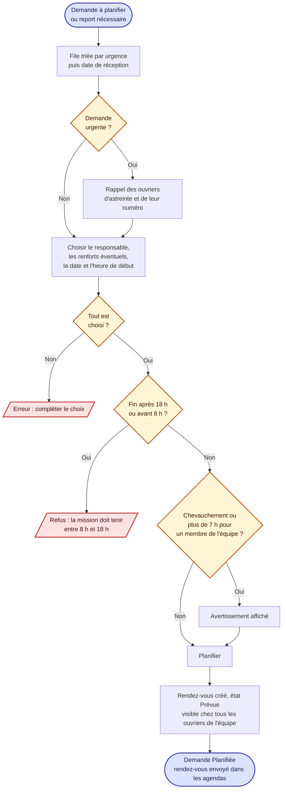
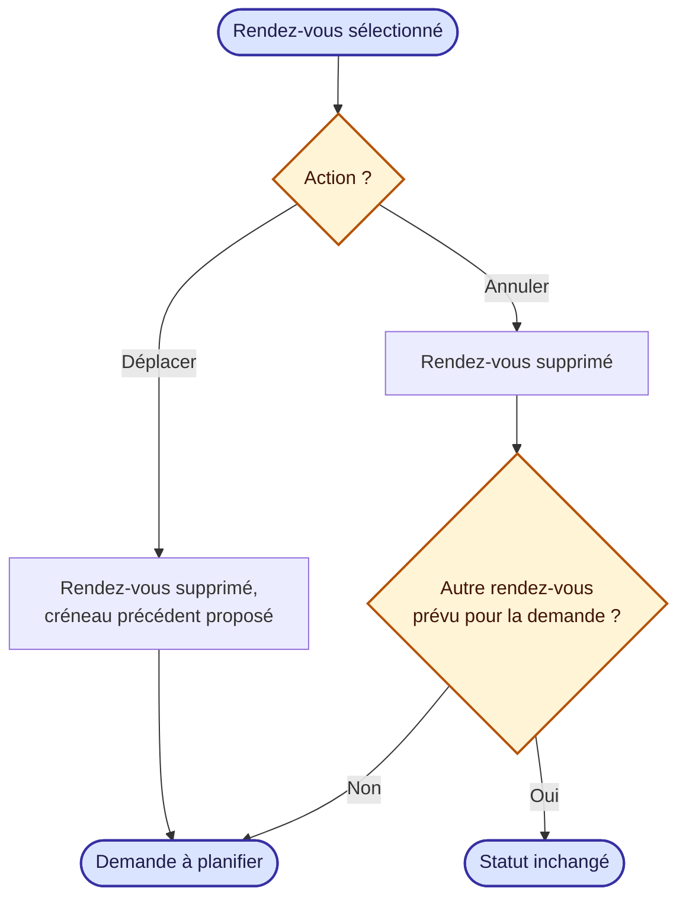
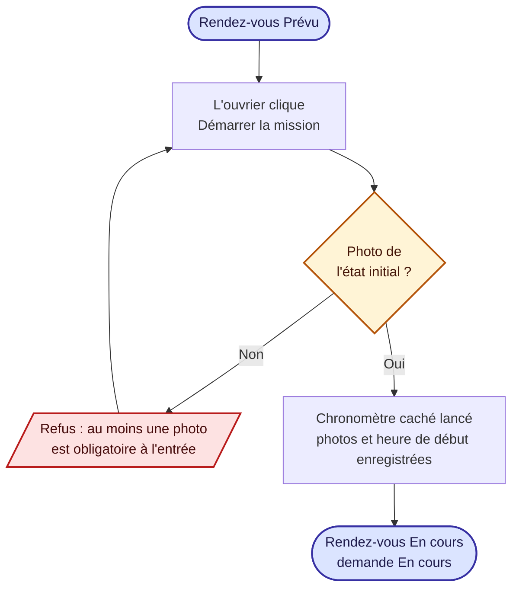
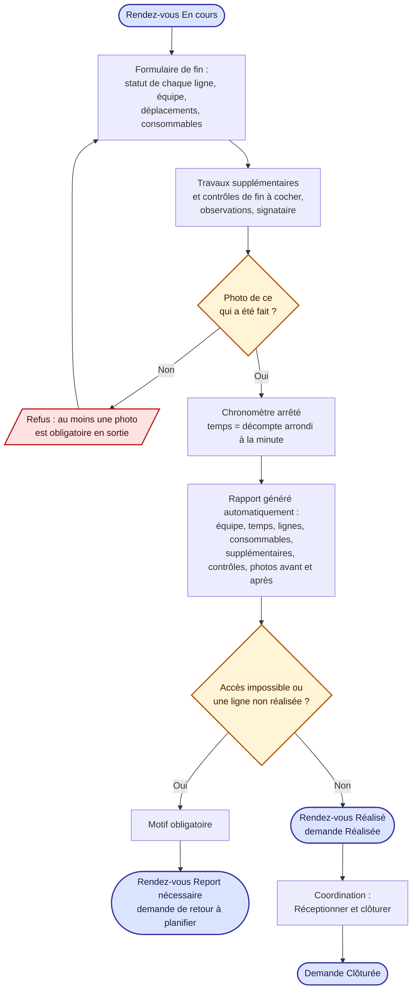
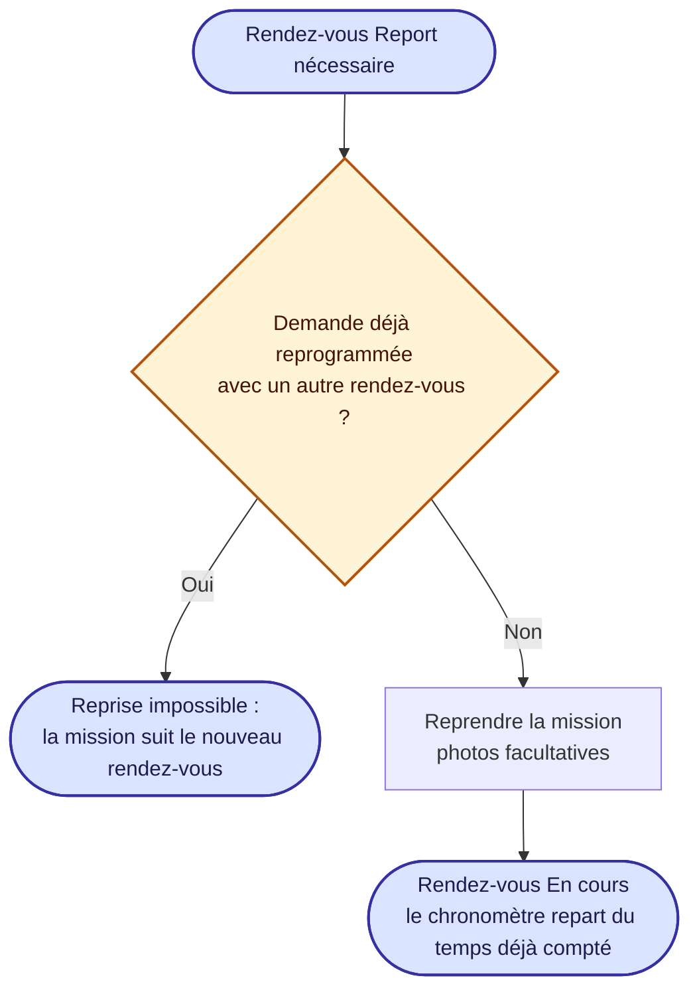

# 5. Planification, déroulement et fin de mission

Sources : `components/Planning/PlanPanel.tsx`, `AppointmentPanel.tsx`, `helpers.ts`, `helpers/mission.ts`.

## 5.1 Planification

Plage de travail : **8 h – 18 h** ; charge maximale **7 h par jour** et par ouvrier. Plusieurs ouvriers peuvent partager une mission (un responsable + des renforts) : les contrôles s'appliquent à chacun.

## 5.2 Modification d'un rendez-vous prévu

## 5.3 Démarrage de la mission

Le temps du rapport vient d'un chronomètre caché (jamais affiché), lancé au démarrage ou à la reprise.

## 5.4 Fin de mission et rapport

## 5.5 Reprise d'une mission reportée

