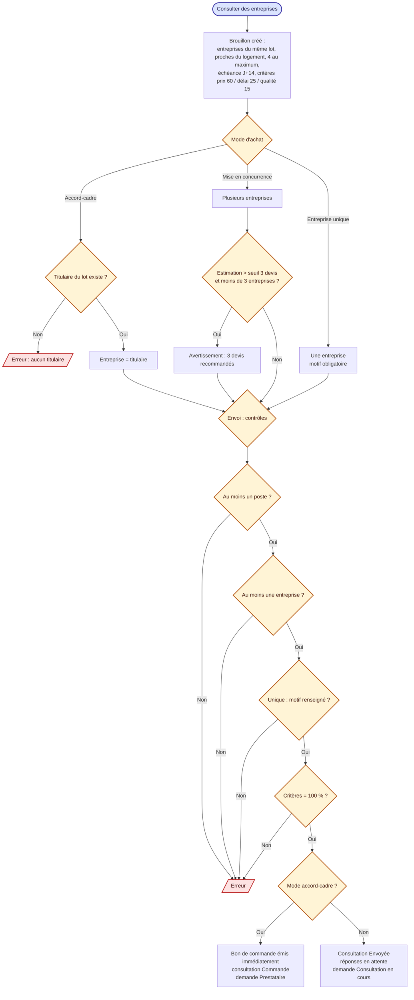
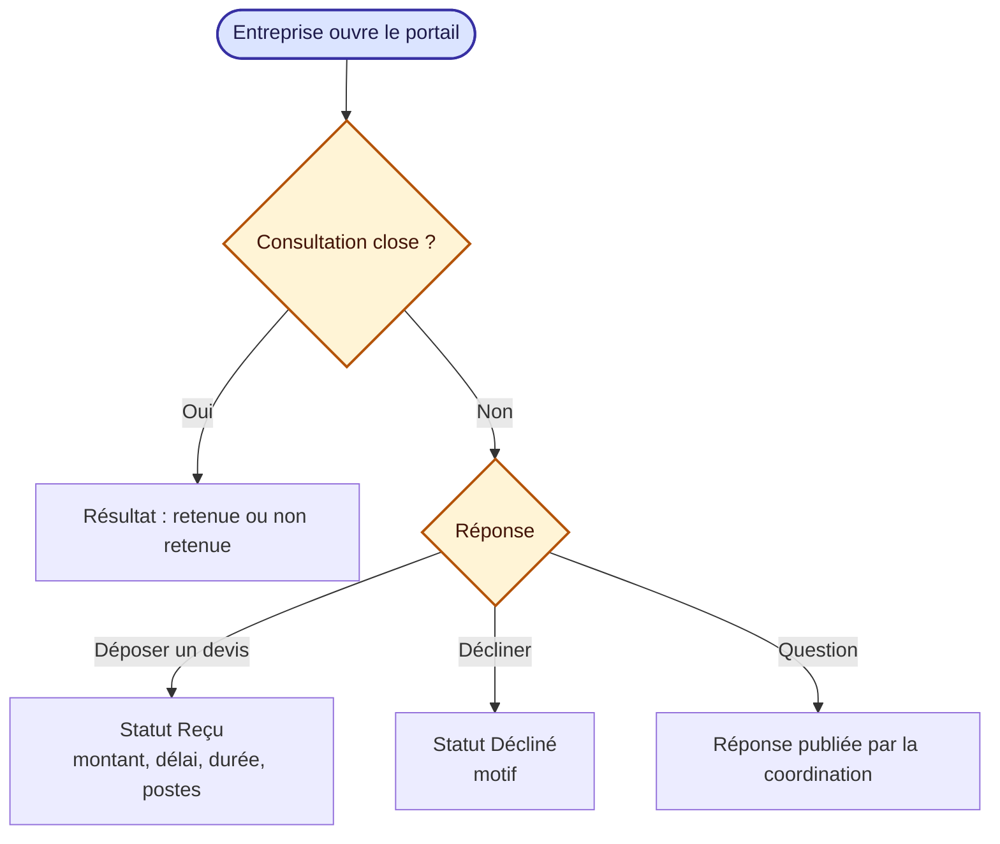
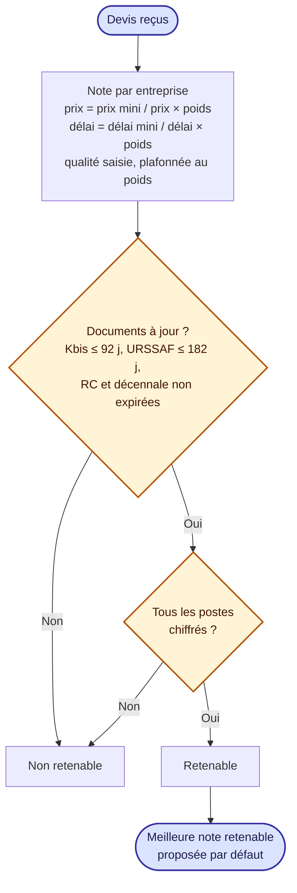
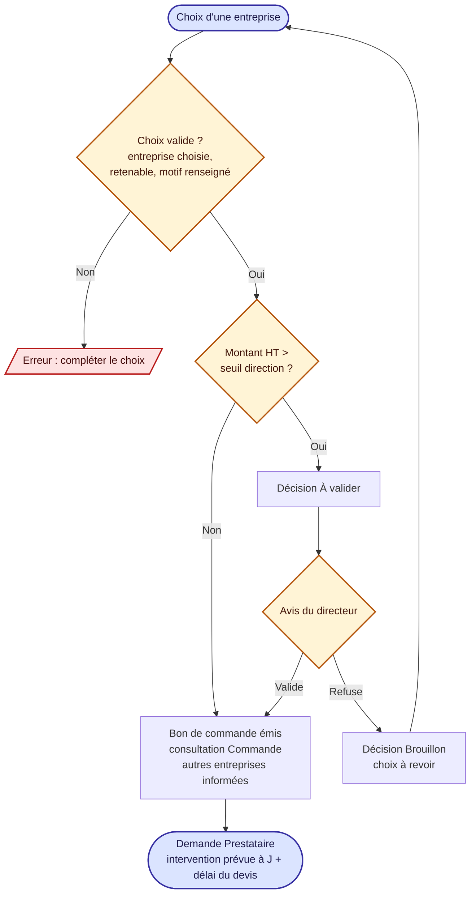
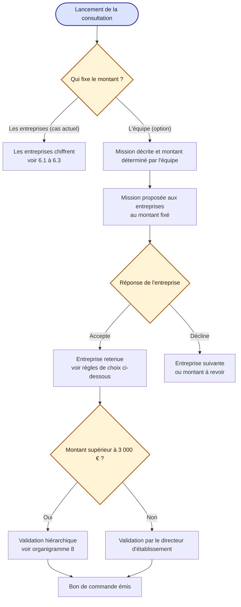

# 6. Consultation d'entreprises, devis et décision

Sources : `components/Consultation/`, `components/Quotes/`, `components/Portal/`.

## 6.1 Lancement de la consultation

## 6.2 Réponse de l'entreprise (portail)

## 6.3 Notation des devis

## 6.4 Décision

Seule la direction valide un choix soumis (`S.profil === 'dir'`). Les seuils (3 devis, direction) se règlent dans les référentiels.

## 6.5 Option cible : mission et montant proposés par l'équipe

Option **non implémentée** dans le site (schéma cible). Au lancement de la consultation, l'équipe peut choisir de fixer elle-même le montant de la mission, au lieu de laisser les entreprises chiffrer.

Points à préciser : si plusieurs entreprises acceptent, comment est choisie celle qui réalise la mission (première réponse, critères délai et qualité) ? Le montant fixé par l'équipe est-il visible de toutes les entreprises ?
