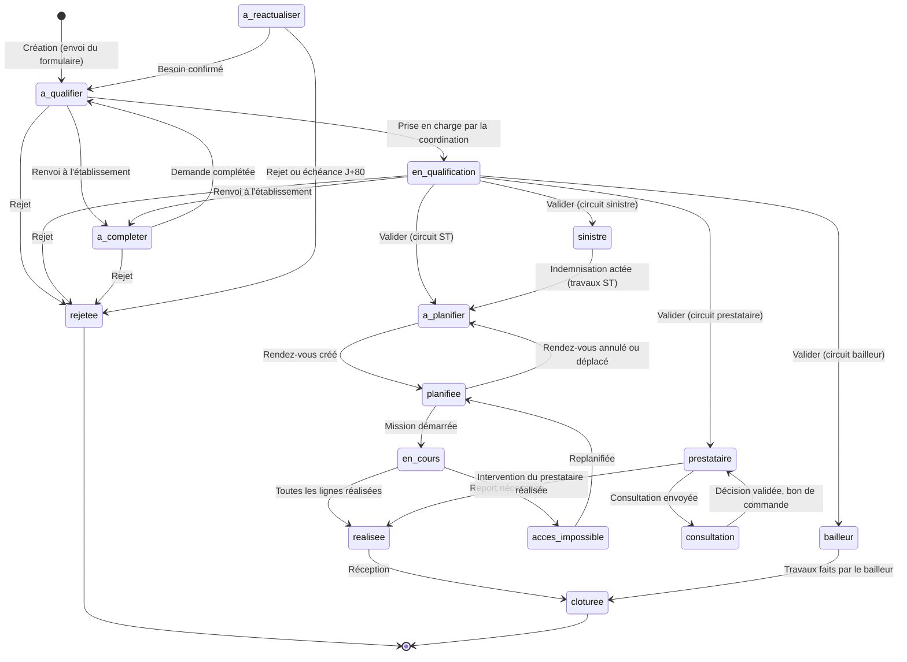

# 7. Cycle de vie d'une demande (vue d'ensemble)

Sources : `helpers/domain.ts` (statuts), `Qualification`, `Planning`, `mission.ts`, `Quotes`.

Statuts terminaux (`CLOSED`) : clôturée, rejetée, annulée. Statuts de qualification (`QUALIF`) : à qualifier, en qualification, à valider (occupant).
