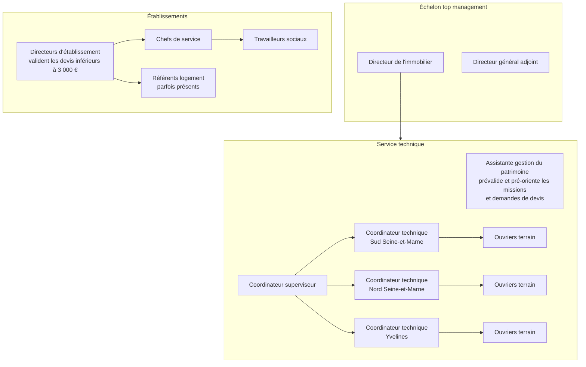
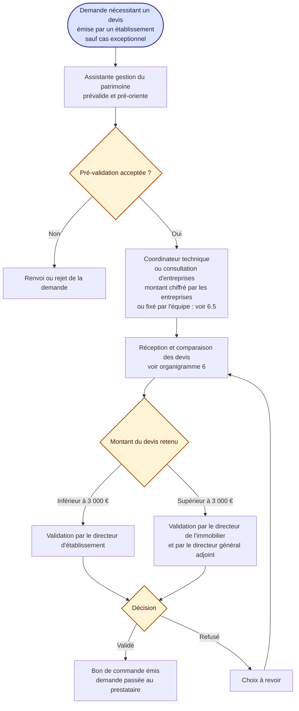

# 8. Hiérarchie des fonctions et niveaux de validation

Source : description donnée par le responsable de l'application (fonctionnement réel). Ce schéma est un **schéma cible** : il décrit l'organisation, pas ce que le site fait aujourd'hui (voir la comparaison en fin de fichier).

Principe : les demandes de travaux émanent des **établissements**, sauf cas exceptionnels.

## 8.1 Organigramme des fonctions

Rattachement des directeurs d'établissement au niveau supérieur : non précisé (à compléter).

## 8.2 Validation d'une demande de devis

## 8.3 Qui encadre qui, qui valide quoi

| Fonction | Encadre | Valide |
|---|---|---|
| Directeur de l'immobilier | Le service technique | Devis supérieurs à 3 000 € (avec l'autre directeur) |
| Directeur général adjoint | (non précisé) | Devis supérieurs à 3 000 € (avec l'autre directeur) |
| Directeur d'établissement | Chefs de service, référents logement | Devis inférieurs à 3 000 € |
| Chef de service | Les travailleurs sociaux | (non précisé) |
| Assistante gestion du patrimoine | (aucun) | Prévalidation et pré-orientation des missions et demandes de devis |
| Coordinateur superviseur | Les 3 coordinateurs techniques | (non précisé) |
| Coordinateur technique (3 secteurs) | Les ouvriers de son secteur | (non précisé) |

## Points à préciser

- Le montant est-il **HT ou TTC** ?
- Un devis d'**exactement 3 000 €** relève de quel niveau ?
- Le directeur d'établissement valide-t-il uniquement les devis de **son** établissement ?
- Un **ouvrier** peut-il être rattaché à un seul coordinateur ? Les **secteurs** (Sud 77, Nord 77, Yvelines) déterminent-ils la répartition des missions ?
- Qui valide les autres décisions : refacturation à l'usager, rejet d'une demande, travaux supplémentaires, fin de prise en charge ?

## Écarts avec le site actuel

- Le site n'a **qu'un seuil de validation** (« direction », réglé dans les référentiels) et **seul le rôle Directeur** peut valider un choix au-dessus. Il n'y a pas de validation par le directeur d'établissement en dessous.
- Les rôles **Directeur général adjoint**, **Assistante gestion du patrimoine**, **Coordinateur superviseur** et **Référent logement** n'existent pas.
- Les **trois coordinateurs par secteur** ne sont pas distingués : un seul rôle « Coordinateur ».
- La **prévalidation** par l'assistante n'existe pas : la coordination qualifie directement la demande.
- L'option « montant fixé par l'équipe » (6.5) n'existe pas : les entreprises chiffrent toujours.
