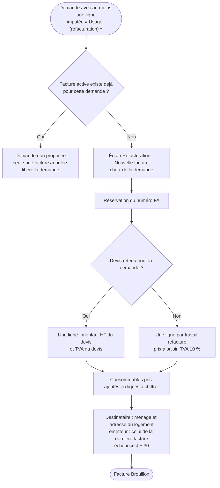
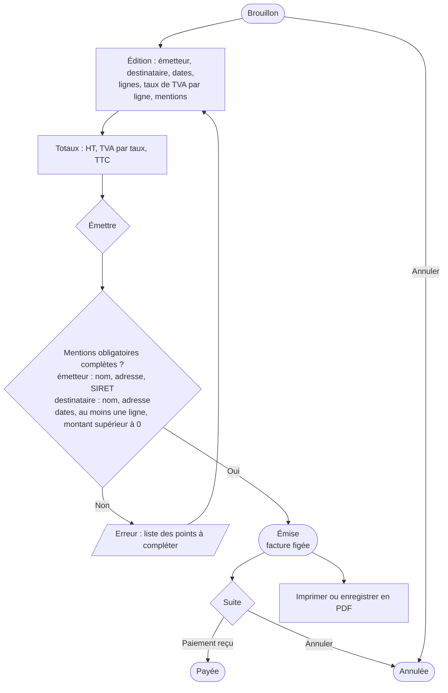

# 9. Refacturation à l'usager

Sources : `components/Billing/`, `components/Invoice/`, `helpers/billing.ts`.

## 9.1 Création de la facture

## 9.2 Vie de la facture

Une facture annulée garde son numéro. Une facture payée ne peut plus être annulée.
